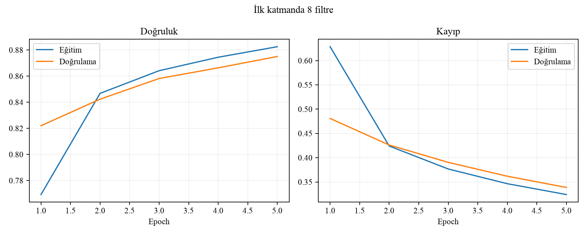
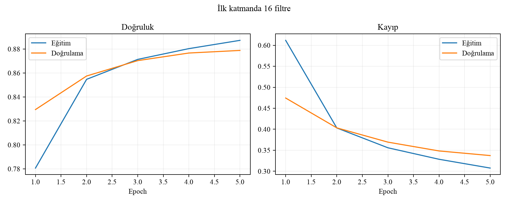
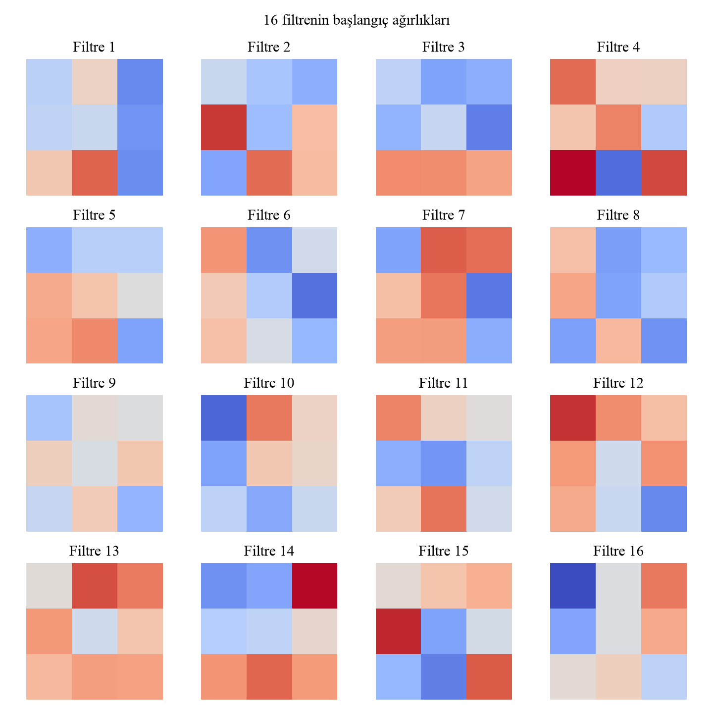

# Fashion-MNIST CNN Study

**Uğurcan DOĞAN** · Deep Learning Assignment · Python / TensorFlow / Keras

A study of how a convolutional neural network transforms grayscale clothing images into class probabilities. The project combines small, inspectable layer examples with two controlled Fashion-MNIST training experiments.

The report and presentation are in Turkish. This guide explains the project in English.

## Report and presentation

- **[Word report](Ugurcan_DOGAN_Rapor.docx)** — theory, tensor dimensions, layer calculations, training curves and discussion.
- **[Presentation](Ugurcan_DOGAN_Sunum.pptx)** — 16 slides with editable tables and training charts.
- **[Assignment brief](yonerge/ÖDEV.docx)** — the original requirements.

Both documents use **Times New Roman**. Files are provided individually.

## Experiment results

Both models use the same dataset split, random seed, optimizer, batch size and number of epochs. Only the number of filters in the first convolutional layer changes.

- **8 filters:** 88.25% training accuracy, 87.50% validation accuracy and **87.18% test accuracy**. Test loss: 0.3611. Training time: 8.94 seconds. Trainable parameters: 27,562.
- **16 filters:** 88.72% training accuracy, 87.88% validation accuracy and **87.53% test accuracy**. Test loss: 0.3530. Training time: 10.91 seconds. Trainable parameters: 28,794.

In this run, the larger model improved test accuracy by **0.35 percentage points** and took approximately **1.96 seconds longer** to train. A single seed and five epochs do not establish a general advantage for larger models. Timing covers `model.fit`, including its initial preparation, and depends on the machine.

Exact measurements are available as [CSV](sonuclar/karsilastirma.csv) and [JSON](sonuclar/sonuclar.json). Re-evaluating both saved models on all **10,000 test images** reproduced the recorded accuracy and loss within numerical tolerances. The verification output includes confusion matrices in [dogrulama.json](sonuclar/dogrulama.json).

### Training curves

**First convolution: 8 filters**



**First convolution: 16 filters**



## What the model does

The input is a `28 × 28 × 1` image. The network applies:

```text
Conv2D(8 or 16, 3×3, ReLU)
MaxPooling2D(2×2)
Conv2D(16, 3×3, ReLU)
MaxPooling2D(2×2)
Flatten → 400 features
Dense(64, ReLU)
Dense(10, Softmax)
```

Both convolutions use valid padding and stride 1. For the eight-filter model, the spatial dimensions change from 28 to 26, 13, 11 and finally 5. The second pooling output contains `5 × 5 × 16 = 400` values.

Training uses Adam, sparse categorical cross-entropy, five epochs, batch size 64 and seed 42. Of the 60,000 training images, 54,000 are used for fitting and the last 6,000 for validation through `validation_split=0.1`. The separate 10,000-image test split is used after training. Pixels are converted from `uint8` to `float32`, divided by 255 and given a channel axis.

## Project structure

```text
.
├── Ugurcan_DOGAN_Rapor.docx
├── Ugurcan_DOGAN_Sunum.pptx
├── cnn_odev.py                 # Command-line entry point
├── requirements.txt           # Pinned environment dependencies
├── kodlar/
│   ├── ortam.py               # Runtime settings and paths
│   ├── katmanlar.py           # Convolution, pooling and activations
│   ├── egitim.py              # Preprocessing, CNN construction and training
│   └── dogrulama.py           # Full saved-model re-evaluation
├── tests/
│   ├── test_cnn.py            # Numerical and behavioral tests
│   └── test_deliverables.py   # Saved results and document checks
├── sonuclar/                  # Plots, saved models and measurements
└── yonerge/                   # Original assignment brief
```

## Setup

The original run used **ServBay Python 3.11.16** and **TensorFlow 2.21.0** on macOS. From the repository directory:

```sh
/Applications/ServBay/package/python/3.11/current/bin/python3 -m venv .venv
.venv/bin/python -m pip install -r requirements.txt
```

Without ServBay, create the environment with an installed Python 3.11 interpreter, for example `python3.11 -m venv .venv`. On Windows, use `.venv\Scripts\python.exe` in place of `.venv/bin/python`.

The first dataset-dependent run requires internet access. Fashion-MNIST is then cached under `.keras/datasets/`. The virtual environment and runtime caches are excluded from Git.

## Run the project

Run the layer examples without downloading the dataset or training a model:

```sh
.venv/bin/python cnn_odev.py --layers-only --output-dir .build/layer-demo
```

Run the complete assignment, preserving the submitted measurements:

```sh
.venv/bin/python cnn_odev.py --output-dir .build/new-experiment
```

Running without `--output-dir` writes to `sonuclar/` and replaces existing generated results. The Word report and presentation describe the submitted run and do not update automatically when experiments are rerun.

## Verification

Run the **17 offline tests**:

```sh
.venv/bin/python -m unittest discover -s tests -v
```

The suite checks hand-calculated pooling, an independent NumPy Softmax calculation, ReLU behavior, convolution dimensions, preprocessing boundaries, invalid inputs, both model architectures and parameter counts, normalized outputs and a real optimizer update. It also checks saved-model loading, CSV/JSON agreement, epoch histories, filter weights, image integrity, Office package integrity, presentation slide count and document font declarations.

Re-evaluate both submitted models on the entire Fashion-MNIST test split:

```sh
.venv/bin/python -m kodlar.dogrulama
```

This command performs **no retraining**. It verifies probability distributions, test accuracy, test loss and confusion-matrix totals, then refreshes `sonuclar/dogrulama.json`. Accuracy must match within `1e-6` and loss within `1e-5`. Different TensorFlow versions or hardware may produce small numerical differences. Offline tests do not replace this full dataset check or a visual review of the documents.

## Layer visualization

The 16 kernels below come from the standalone convolution example before training. They are initialization weights, not learned Fashion-MNIST features. All kernels share the same color scale.



## References

- [TensorFlow clothing classification tutorial](https://www.tensorflow.org/tutorials/keras/classification)
- [Conv2D API](https://www.tensorflow.org/api_docs/python/tf/keras/layers/Conv2D)
- [MaxPooling2D API](https://www.tensorflow.org/api_docs/python/tf/keras/layers/MaxPooling2D)
- [HeNormal initializer](https://www.tensorflow.org/api_docs/python/tf/keras/initializers/HeNormal)
